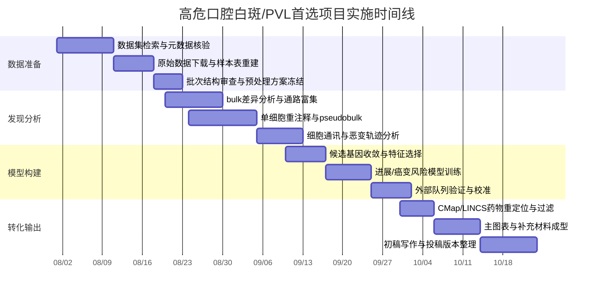
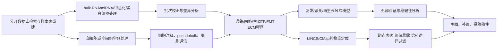

# 六个方向的纯生物信息学深度可行性报告

## 执行摘要

这六个方向里，**最适合优先启动**的是**高危口腔白斑/PVL**与**无功能垂体神经内分泌肿瘤术后再生长**。前者的优势在于：公开数据已经覆盖了**恶变前病变、进展/未进展结局、单细胞层面异质性**，可以把“复发/持续进展/癌变风险”做成一篇目标非常清楚的转化生信论文；后者的优势在于：虽然真正带长期影像随访的原始公开组学数据仍需逐条核验，但已经出现了**117例甲基化+长期随访**的高质量研究框架，加上公开的转录组与近年的单细胞/空间组学，最容易做成**预后分层+机制整合**型稿件，理论上上限最高。相比之下，**PVR**与**SNIP**非常像翼状胬肉，都是“药物疗效有限、以手术为主、术后复发显著”的局灶性增殖性病变，但它们的公开数据体量偏小，适合做“多组学整合+外部验证+药物重定位”的中等篇幅精品文章；**乳腺叶状肿瘤**和**瘢痕疙瘩/跨器官纤维增殖病**的数据最容易做出“机制图谱”，但前者缺少标准化复发标签公开队列，后者竞争已经明显增多，需要把研究设计做成“跨疾病共性纤维化程序”才更有新意。citeturn19search1turn18search0turn14view0turn26search5turn42search4

从“**与翼状胬肉的类比强度**”看，最接近的其实是**PVR、SNIP、瘢痕疙瘩**：它们都具有**慢性炎症驱动、局灶性纤维增殖、手术是主要治疗手段、术后复发仍是核心临床痛点**等共同点。**高危口腔白斑/PVL**的相似点更多体现在“病灶边界不稳定、局灶切除后仍可复发/持续进展、缺乏确立的药物控制策略”，而**NF‑PitNET**与**乳腺叶状肿瘤**则更像“需要术后风险分层来决定监测/再干预强度”的队列研究问题。也因此，这六个方向并不是谁“绝对更好”，而是适合不同投稿层级：如果你追求**最稳的中高分纯生信文章**，首选高危口腔白斑/PVL；如果追求**上限更高但元数据核验更重**，首选NF‑PitNET术后再生长。citeturn0search3turn0search4turn15search7turn15search8turn25search3turn26search9turn33search5

下面这张总表先给出我对六个方向的**综合可发表性评分**与优先顺序。评分不是“疾病重要性”，而是综合了**公开数据完备度、结局标签可得性、纯生信可做深度、目标期刊适配度、同质化竞争程度**后的可执行性判断。citeturn1view2turn14view0turn19search1turn22view0turn27view1turn32view2

| 方向 | 与翼状胬肉类比强度 | 公开数据完备度 | 结局标签可得性 | 目标期刊上限 | 可发表性评分 |
|---|---:|---:|---:|---:|---:|
| 高危口腔白斑/PVL | 高 | 高 | 中-高 | 中高 | **8.8/10** |
| 无功能垂体神经内分泌肿瘤术后再生长 | 中 | 中-高 | 高 | 很高 | **8.7/10** |
| 鼻窦倒置乳头状瘤 | 很高 | 中 | 中 | 中高 | **8.2/10** |
| 瘢痕疙瘩/跨器官复发性纤维增殖病 | 很高 | 高 | 中 | 高 | **8.0/10** |
| 增殖性玻璃体视网膜病变 | 很高 | 中 | 低-中 | 中高 | **7.8/10** |
| 乳腺叶状肿瘤 | 中-高 | 中 | 低-中 | 高 | **7.6/10** |

我建议把**首发项目**定为“高危口腔白斑/PVL的恶变-复发一体化风险转录组学”，因为它最容易在**不做实验、只做公开数据重分析**的前提下形成一篇结构完整的文章：发现队列、单细胞注释、进展/癌变风险模型、外部验证、药物重定位，这五块都能在现有公开资源上闭环。PVR、SNIP 和 keloid 则很适合做第二梯队，因为三者的“局部炎症-EMT-ECM重塑-复发”框架天然适合写成**翼状胬肉类疾病谱系研究**。citeturn0search0turn0search1turn14view0turn26search5turn32view2

首选方向建议使用如下时间线。这里按**十二到十四周**设计，默认你已有标准 R/Python 生信环境，且不做任何实验补充。这个排期的核心思想是：前四周把数据与元数据“吃透”，中间四周把模型和多组学整合做扎实，最后四周集中打磨图表和投稿稿件。citeturn0search0turn0search1turn1view2

建议的计算资源不需要高性能集群，但至少要有：**内存 64–128 GB、16 核 CPU、2 TB SSD**；如果你要重跑单细胞标准流程并做整合，128 GB 会明显更舒服。软件栈建议固定为：R 端使用 **GEOquery、limma、edgeR、DESeq2、sva、WGCNA、glmnet、survival、survminer、maftools、ComplexHeatmap、clusterProfiler、fgsea、Seurat、SingleR、scater、scran、muscat、infercnv、CellChat 或 CellPhoneDB 接口**；Python 端使用 **scanpy、scvi-tools、anndata、lifelines、gseapy、PyDESeq2、scikit-learn、statsmodels**。如果做甲基化整合，再加 **minfi、ChAMP、DMRcate**；做蛋白组整合，则加 **DEP、MSstats**。这是目前最稳、最接近审稿人预期的一套组合。citeturn19search1turn12search3turn22view2

通用分析框架建议如下。无论六个方向中的哪一个，真正能把文章拉开差距的，不是“又做了一次DEG”，而是把**疾病组织成分、复发/进展结局、跨数据类型一致性、与药物可干预性的连接**做成一个闭环。citeturn11search2turn18search0turn22view2turn32view2

## 高危口腔白斑与 PVL

### 临床背景与为何适合作为翼状胬肉类比模型

高危口腔白斑，尤其是 **PVL**，与翼状胬肉非常适合做方法学类比：二者都表现为**局部慢性炎症背景下的异常上皮/基质重塑**，药物治疗缺少公认、稳定、可重复的长期控制效果，临床上仍高度依赖切除或反复局部处理，但病灶具有**复发、持续进展、甚至进一步恶变**的倾向。PVL 的临床难点在于：它往往不是一次性“切干净就结束”的病，而是一个**长期演化的场癌变过程**；这就非常适合通过公开数据做“病灶生态位—恶变风险—药物可逆转签名”的纯生信研究。citeturn0search3turn0search4

### 可用公开数据集

目前最值得优先使用的公开资源，是一个**带进展结局的口腔癌前病变 bulk 队列**，再叠加 **PVL/OPMD 单细胞数据** 与较大的公开 **bulk RNA‑seq** 队列。真正有价值的不是单一数据集，而是它们之间的互补性：GSE26549 负责“进展/未进展”结局；GSE196296 负责细胞组成与生态位异质性；GSE227919 负责扩大样本量与提高转录组分辨率。citeturn0search0turn0search1turn1view2

| 数据库 | 系列号 | 样本量与类型 | 是否含复发/进展/恶变结局 | 访问限制 | 建议用途 |
|---|---|---|---|---|---|
| GEO | **GSE26549** | 17 progressing OPL、19 non-progressing OPL、另含 86 HNSCC；芯片数据 citeturn0search0 | **含进展结局** | 开放 | 发现“癌变前风险签名”的核心队列 |
| GEO | **GSE196296** | 单细胞 RNA‑seq；59 个 OPMD 样本、8 个正常黏膜，来自 8 名患者的病灶体系 citeturn0search1 | 结局标签未完全公开/需核验 | 开放 | 注释上皮亚群、CAF/免疫生态位、pseudobulk |
| GEO | **GSE227919** | 99 个样本的口腔潜在恶性病变 RNA‑seq；包含正常、低危、中高危、癌变相关层级 citeturn1view2 | 恶变随访未在系列页完整公开/需核验 | 开放 | 外部验证、分层差异分析、风险模型校准 |
| 相关甲基化研究 | PVL/均质白斑差异甲基化研究 | 系列号在公开页面上未直接检出，**未公开/需核验** citeturn4search0 | 需核验 | 需核验 | 若能定位原始甲基化文件，可显著提升文章层级 |

### 推荐题目、终点与多组学路线

我最推荐的题目是：**“基于公开 bulk 与单细胞转录组整合的高危口腔白斑/PVL 恶变与持续进展风险图谱及药物重定位研究”**。主终点建议设成两个层面：第一是 **progressing vs non‑progressing OPL/PVL**；第二是 **从正常—低危—高危—癌变的连续风险梯度**。这样主文可以一口气回答三个问题：哪些基因是“真的与进展有关”；这些基因来自哪类细胞；它们能否被已有药物逆转。citeturn0search0turn0search1turn1view2

具体路线建议分成四层。第一层是 **bulk 发现分析**：对 GSE26549 和 GSE227919 分别做标准化、探查离群样本、按平台选择 limma 或 DESeq2，之后只在**基因层**做跨平台整合；批次校正优先用 ComBat，但不要把“疾病状态”和“批次”混到不可辨认。第二层是 **单细胞定位**：利用 GSE196296 重新注释上皮、基底样细胞、炎症成纤维细胞、髓系细胞与 T 细胞，重点看 **basal/progenitor-like 上皮群**、**POSTN/TGFBI/THBS2 富集的基质群** 和 **SPP1+ 髓系群** 是否在高风险病灶中富集。第三层是 **pseudobulk 与混合效应模型**：按患者聚合每个主要细胞群表达矩阵，用 `~ risk_group + age/sex(if available) + (1|patient)` 的思路评价细胞群特异 DEGs，避免把细胞数当样本数。第四层是 **风险模型**：先用 LASSO 或 elastic net 收缩特征，再在外部 bulk 队列中做 ROC、PR、校准曲线与 decision-curve analysis。citeturn0search1turn1view2turn0search0

如果你希望把文章再拉高一个层级，就把主轴从“DEG 列表”改成“**恶变前程序**”。具体可以围绕 **EMT‑partial EMT、细胞周期加速、角化异常、免疫逃逸、ECM 重塑** 五个模块做 ssGSEA/GSVA，然后把这些模块与单细胞来源做映射。审稿人最喜欢看到的，不是单个 hub gene，而是“**高危病灶由哪种细胞程序组成**”。这一点在 PVL/OPMD 上尤其重要，因为它本来就是一个空间与时间高度异质的病。citeturn0search1turn1view2

### 样本量、功效、风险与补救

这个方向的主要优势是：**发现和验证可以分开做**。GSE26549 虽然样本不算大，但有直接进展标签；GSE227919 样本数更大，可作为验证；GSE196296 虽然不是结局队列，但足以做单细胞定位。经验上，若 bulk 发现集每组在十例上下且效应不小，配合外部验证，已经足以支持一篇以“风险签名+细胞来源解析”为核心的文章；真正的风险不是样本量，而是**结局定义异质**与**病理分层口径不一**。因此，元数据整理必须放在最前面，尤其要明确“progression”“dysplasia grade”“malignant transformation”是否等义。citeturn0search0turn1view2

补救策略也很清楚。如果后续核验发现某些系列的随访标签并不完整，就把论文主轴从“时间结局预测”调整为“**高危病灶状态分类**”，仍然可以做出可发表稿；同时把 GSE196296 里单细胞得到的细胞群 signature 投射回 bulk 队列，做去卷积和风险分层。这样即便没有严格的 Cox 结局模型，文章仍然具备机制深度。citeturn0search1turn1view2

### 候选药物重定位与目标期刊

药物重定位建议严格按四步过滤。第一步，用 progressing/PVL 高风险 signature 去做 **LINCS/CMap 负连接评分**；第二步，保留能逆转核心模块而不是只逆转少数单基因的药物；第三步，过滤掉**口腔局部不可达、毒性明显高于预期应用场景**的候选；第四步，优先保留已在头颈肿瘤、口腔黏膜病、炎症‑纤维化通路中有生物学合理性的药物类别，例如 **EGFR/ERBB、PI3K‑AKT、COX‑2/炎症轴、YAP/TEAD、TGF‑β 相关调节剂**。在文稿里不要把它们写成“治疗推荐”，而应写成“**transcriptome‑matched candidate compounds**”。citeturn39search9turn0search0turn0search1

可投稿期刊建议按“**最有希望命中**”排序如下。这里我优先列出**支持非OA/有订阅路径或至少不是强制OA**的目标，但需要说明：口腔领域目前真正 **JIF 稳定高于 3 且明确非OA无APC路径** 的可选面，已经没有前几年宽。最现实的做法是把第一目标放在 **Oral Oncology** 这类影响因子合格、审稿口径重转化价值的期刊；如果你强烈坚持“非OA且无APC”，就要接受目标期刊分值略低或者需要走病理/肿瘤综合刊。citeturn39search9turn37search4turn36search1

| 期刊 | 官网当前影响因子信息 | OA路径 | 是否可选非OA无APC路径 | 适配度 |
|---|---:|---|---|---|
| **Oral Oncology** | **3.9**；ScienceDirect 官方显示 “Supports open access” citeturn39search9 | 混合 | **是** | 最匹配 |
| **Virchows Archiv** | **3.0（2025）**；Springer 官方显示 Hybrid citeturn43search1 | 混合 | **是** | 若文章更偏病理分层/分子病理 |
| **International Journal of Oral and Maxillofacial Surgery** | 官网搜索结果可见为传统 Elsevier 订阅刊页面，具体当前IF需JCR端复核 citeturn38search7 | 混合/需核验 | 大概率是 | 若文章更偏手术队列与病理转化 |
| **Oral Diseases** | 官网当前 IF **2.9**，低于你设定的 3 分门槛，不列为主推 citeturn37search0 | 混合 | 是 | 备选，不作主投 |

**最终可发表性评分：8.8/10。** 扣分点主要是：PVL 特异型公开随访标签并不如理想中完整；加分点则是疾病生物学清楚、公开数据能形成“发现—定位—验证—重定位”闭环。citeturn0search0turn0search1turn1view2turn39search9

## 增殖性玻璃体视网膜病变

### 临床背景与类比逻辑

PVR 是我认为**与翼状胬肉生物学最像**的方向之一。它本质上也是一种局部组织损伤后的异常修复和纤维增殖：炎症激活、细胞迁移、ECM 过度沉积、膜性组织形成，再导致牵拉和复发。临床上，PVR 依然是导致视网膜脱离修复失败的关键原因，而现阶段**缺乏被普遍接受、能稳定改变疾病自然史的药物治疗**，主要还是靠玻切+膜剥离等手术方案。这个“**无成熟药物、手术为主、复发导致再手术**”的临床图景，与翼状胬肉高度同构。citeturn13search0turn11search0turn10search1

### 可用公开数据集

PVR 的公开数据体量不算大，但质量不错，尤其适合做“**转录组 + 蛋白组 + 细胞组成**”整合。最核心的是 **GSE179603/PRJNA744251**，它给了人源 PVR 膜、黄斑前膜和 ILM 的 RNA‑seq；再加上 PRIDE 的 **PXD028539** 玻璃体外泌体蛋白组，以及已发表的人源 PVR 膜蛋白组研究，就足够支撑一篇多组学整合稿。citeturn14view0turn12search3turn10search1

| 数据库 | 系列号 | 样本量与类型 | 是否含复发/随访结局 | 访问限制 | 建议用途 |
|---|---|---|---|---|---|
| GEO / SRA | **GSE179603 / PRJNA744251 / SRP327213** | 10 人 PVR 膜、10 黄斑前膜、7 ILM；RNA‑seq，原始数据在 SRA，处理矩阵开放 citeturn14view0 | **不含标准长期复发标签** | 开放 | 主发现队列 |
| PRIDE | **PXD028539** | 人玻璃体外泌体蛋白组；PVR 分期比较 citeturn12search3turn12search7 | 无长期随访 | 开放 | 蛋白组整合、分泌程序 |
| 文献配套数据 | 2022 IOVS PVR 膜转录组+IMC | 44 个组织：19 PVR、13 ERM、12 ILM；文中给出 RNA‑seq、xCell、IMC 框架 citeturn11search0turn11search2 | 无长期随访 | 原始可及性需逐项核验 | 细胞成分与药物重定位参考 |
| GEO | **GSE41019** | 早期 PVR 相关纤维膜表达谱；样本量较小 citeturn12search1 | 无 | 开放 | 早期验证/历史交叉验证 |

### 推荐题目、终点与分析路线

最适合 PVR 的题目不是“找 hub gene”，而是：**“人源 PVR 膜的细胞生态位与 ECM‑炎症耦合程序的多组学整合及药物逆转分析”**。主终点建议不是“复发”，因为公开数据里几乎没有可直接用于 Cox 的随访标签；应改成 **PVR vs ERM/ILM** 的病理状态终点，并把“高纤维化‑高炎症分子程序”作为可量化轴。这样更符合数据现实，也更容易过审。citeturn14view0turn11search0turn10search1

bulk 端建议先在 GSE179603 中完成标准化与 PCA，随后做 **PVR vs ILM、PVR vs ERM** 双重比较，取交集定义“PVR 核心病理程序”。然后将这些基因投射到蛋白组，建立“**膜组织表达—玻璃体分泌物表达**”双层一致模型，重点关注 **FN1、SPARC、COL1A1/2、COL3A1** 等 ECM 主轴，以及免疫‑髓系相关分子。单细胞层面，如果拿不到原始 IMC/RNA 计数，可以采用作者论文中已经明确的优势细胞群作为先验，再用公开单细胞/单细胞成像结果支持你对 bulk 的去卷积解释。citeturn11search2turn10search1turn14view0

统计路线建议强调“**小样本稳健性**”。PVR 公开数据常见问题不是批次太多，而是每个批次都很小。因此建议使用：`voom-limma` 或 DESeq2 的 shrinkage 差异分析；通路层优先用 `fgsea`、`camera` 等基于排序的方法，少依赖硬阈值；网络层用 `WGCNA` 时把重点放在模块‑表型关系，不要过度解读单个连接度。蛋白组整合可以采用“共同富集通路 + 跨层 rank aggregation”的方式，而不要简单做转录/蛋白交集。citeturn14view0turn12search3turn10search1

### 样本量、风险、药物重定位与期刊

PVR 方向最关键的风险，是**临床终点公开度不足**。它的强项在病理机制，不在预测复发随访。因此这篇文章的设计应主动承认：这是“**状态解析**”而非“预后模型”。如果你硬要做 recurrence 预测，审稿人反而容易质疑终点不充分。补救办法是把验证做足：至少在另一个 PVR 或相关膜性增殖数据集中，重复验证 ECM/炎症核心模块。citeturn14view0turn12search1

药物重定位方面，这个方向反而很有优势，因为已有研究已经用转录组反连通性筛出了一批候选药物。你可以在此基础上**二次升级**：重新跑 LINCS/CMap，把候选药物按三层过滤——第一层看负连接分数；第二层看靶点是否在 PVR 膜组织/外泌体蛋白中表达；第三层看给药途径是否符合眼内局部应用逻辑。和文章中已报道的 **aminocaproic acid、topoisomerase‑2A inhibitors** 相比，更值得保留的是那些**眼内可达、局部毒性可控**的候选，而不是简单追求 connectivity 分数最高。citeturn11search0turn14view0

| 期刊 | 官网当前影响因子信息 | OA路径 | 是否可选非OA无APC路径 | 适配度 |
|---|---:|---|---|---|
| **Acta Ophthalmologica** | Wiley 页面当前显示 IF **2.8**；低于你设定门槛，不作首推 citeturn39search0 | 混合 | 是 | 备选 |
| **Graefe’s Archive for Clinical and Experimental Ophthalmology** | Springer 未在首页直接给出当前IF；第三方新近指标页显示 **2025/2026 JIF 约 3.0**，且 Springer 官方明确 **Hybrid** citeturn39search11turn40search5 | 混合 | **是** | 最现实 |
| **American Journal of Pathology** | 未在本次检索中逐页核验当前IF，需复核 | 混合/需核验 | 需核验 | 若文章更偏机制病理 |
| **Investigative Ophthalmology & Visual Science** | 适配度高，但本轮未逐页核验 APC/订阅路径，投稿前需核验 | 需核验 | 需核验 | 上限较高 |

**最终可发表性评分：7.8/10。** 优势是类比强、机制清晰；劣势是公开随访标签短板明显。最合适的写法不是“预测复发”，而是“解析促复发程序”。citeturn14view0turn11search0turn12search3

## 无功能垂体神经内分泌肿瘤术后再生长

### 临床背景与为何值得优先

NF‑PitNET 的临床痛点和翼状胬肉不在同一个器官层面，但在“**手术之后谁会再长、谁需要更强监测或辅助治疗**”这个问题上，二者非常一致。非功能垂体肿瘤的治疗核心仍是手术；对 residual/recurrent disease，放疗和 SRS 常被用于再干预，但真正能在术后早期稳定预防再生长的药物策略并不成熟。因此，这个方向的生信价值并不只是解释机制，而是构建**术后风险分层**。citeturn19search1turn15search8turn15search7

### 可用公开数据集

这个方向的公开资源呈现“**公开转录组不少，真正有长期结局的组学数据最值钱但未必全量开放**”的格局。最强的证据来自 2025 年的甲基化研究：**117 例 NFPitNET，长期影像随访，外部三队列验证**；同时还有 GSE51618 等侵袭/非侵袭表达谱、GSE201439 的功能/非功能 PitNET RNA‑seq，以及两套非常重要的单细胞资源：**HRA003483 控制访问的人源 Pituitary tumor scRNA‑seq**，和 2025 年发表的 **57 份组织、17.7 万细胞 + 3.5 万 spot 的 scRNA+空间组学研究**。citeturn19search1turn16view0turn16view1turn18search3turn18search0

| 数据库 | 系列号 | 样本量与类型 | 是否含术后再生长/复发结局 | 访问限制 | 建议用途 |
|---|---|---|---|---|---|
| GEO | **GSE51618** | 10 个样本；非侵袭 NFPA、侵袭 NFPA 与正常垂体微阵列 citeturn16view0 | **不含长期再生长** | 开放 | 侵袭相关发现集 |
| GEO/SRA | **GSE201439 / PRJNA831798** | 25 例 PitNET RNA‑seq，含非功能性促性腺轴肿瘤亚型 citeturn16view1 | 结局未公开/需核验 | 开放 | 亚型转录组背景与外部验证 |
| GSA-Human | **HRA003483** | 人垂体肿瘤 scRNA‑seq，控制访问；2023 公开说明为 pituitary tumor 单细胞研究 citeturn18search3turn18search7 | 结局需核验 | **受控访问** | 人源单细胞参考图谱 |
| 文献队列 | 2025 Neuro-Oncology 甲基化研究 | **117 例 NFPitNET，Illumina EPIC 850K，长期影像随访**，外部 3 队列验证 citeturn19search1 | **含术后 regrowth/PFS** | 原始数据公开性需核验 | 最有价值的结局框架 |
| 文献队列 | 2025 Nature Communications | **57 份组织、>177,000 cells、35,000 spots** 的 scRNA+空间 PitNET 图谱 citeturn18search0 | 直接 recurrence 标签未突出 | 原始访问需核验 | 空间微环境锚定 |
| 文献队列 | 73 例 circRNA / lncRNA recurrence 研究 | 随访建模样本 73 例 NFPA/NF‑PitNET citeturn15search0turn15search2 | **含 recurrence/PFS** | 原始公开性需核验 | 作为结局建模文献对照 |

### 推荐题目与详细路线

这个方向我最推荐的题目是：**“整合甲基化、转录组与单细胞/空间图谱的 NF‑PitNET 术后再生长风险分层模型及微环境机制研究”**。主终点非常明确：**postsurgical regrowth / PFS**。次终点可以是**侵袭性**和**残余肿瘤体积相关分层**。这是六个方向里最适合做成“**预后分层文章**”的。citeturn19search1turn15search7turn15search8

路线建议以甲基化为中轴。第一步，如果原始甲基化数据能拿到，就完全复现 2025 Neuro‑Oncology 的 pipeline：QC、probe filtering、batch assessment、无监督聚类、DMP/DMR 寻找、随机森林或 elastic net 分类器重训；第二步，把分类得到的高风险簇映射到公开转录组，提取与高风险簇一致的表达程序；第三步，把这些表达程序再映射到近年的单细胞/空间 PitNET 图谱里，看它主要落在**SF1 lineage 肿瘤细胞**、**SPP1+ TAM**、还是某些 stromal niche 上。这样文章的结构会非常完整：**表观遗传分型 → 表达程序 → 空间微环境 → 术后风险**。citeturn19search1turn18search0turn18search2

若甲基化原始文件暂时拿不到，可以退而求其次：以公开 RNA‑seq 为主轴，按 **侵袭/非侵袭** 建立表达签名，再利用文献已经公布的高风险甲基化相关基因去做“转录层代理建模”。这是降级但不减分太多的做法，因为审稿人会接受“公开原始甲基化未全量开放，因此进行了 transcriptomic surrogate validation”的策略，只要你写得诚实。citeturn19search1turn16view0turn16view1

### 风险、药物重定位与期刊

这个方向最大的技术风险不是建模，而是**原始结局数据可得性**。一旦甲基化原始矩阵不可用，你就不应该硬凹“复现 117 例甲基化模型”，而应转成“**利用公开转录组与已发表甲基化高风险基因集，构建可迁移的 surrogate risk score**”。我反而认为这在投稿时有优势，因为审稿人会更愿意接受“方法学延伸”而不是“文献重复”。citeturn19search1

药物重定位应围绕该研究提示的**cell cycle、adhesion、immune pathways** 做。真实可写进稿件的候选类别包括 **CDK4/6 抑制剂、PI3K/mTOR 轴干预、HDAC/表观遗传调节剂、可能影响 SPP1‑ITGAV/ITGB1 轴的通路药物**；但必须在文中强调，这些只是依据公开组学的**hypothesis-generating candidates**，不能当作临床推荐。citeturn19search1turn18search0turn18search2

| 期刊 | 官网当前影响因子信息 | OA路径 | 是否可选非OA无APC路径 | 适配度 |
|---|---:|---|---|---|
| **Neuro-Oncology** | OUP 官网明确 **2025 Impact Factor 13.1** citeturn39search4 | 混合 | **是** | 上限最高 |
| **Journal of Neuro-Oncology** | Springer 传统订阅体系，常规可选非OA；当前IF未在本次检索页直接抓到，投稿前需复核 citeturn41search2 | 混合 | **是** | 最现实 |
| **Acta Neuropathologica Communications / npj Precision Oncology** | 相关文章能上，但多数为 OA 路线，不符合你“非OA优先”要求 citeturn18search5turn18search6 | 多为OA | 否/不优先 | 备选 |
| **Pituitary** | 领域吻合，但通常影响因子低于你设定门槛，不列主投 | 混合 | 是 | 备选 |

**最终可发表性评分：8.7/10。** 这是“上限最高、也最依赖元数据核验”的方向。只要结局数据拿得起来，非常有机会冲到六个方向里的最高层级。citeturn19search1turn39search4

## 乳腺叶状肿瘤

### 临床背景与类比逻辑

乳腺叶状肿瘤与翼状胬肉的差异在器官系统，但相似点在**局灶性间质主导的增殖、手术切除仍是核心治疗、局部复发是长期管理重点**。尤其是 borderline/malignant PT，仍以手术为主，而系统性辅助治疗证据有限；目前没有被广泛认可、可稳定替代手术或显著降低复发的标准药物方案。citeturn25search3turn25search8turn25search10

### 可用公开数据集

叶状肿瘤的公开数据有一个非常明显的优势：**分子分型数据种类多**。有可直接区分 fibroadenoma 与 phyllodes 的表达谱，也有覆盖良恶性梯度的甲基化数据，以及病例量相对可观的综合表观/基因组资源。缺点则是：**真正带规范复发结局的公开矩阵很少**。因此，这个方向更适合做“**良性—交界—恶性连续谱系**”而不是传统的 recurrence Cox。citeturn22view0turn24search5turn22view2turn23view0

| 数据库 | 系列号 | 样本量与类型 | 是否含复发/恶变结局 | 访问限制 | 建议用途 |
|---|---|---|---|---|---|
| GEO | **GSE78071** | 48 例 FFPE fibroepithelial lesions；24 fibroadenoma、24 PT；表达芯片 citeturn22view0 | 无长期复发标签 | 开放 | FA/PT 区分发现 |
| GEO | **GSE179458** | 96 例 EPIC 甲基化/拷贝数整合，覆盖 benign/borderline/malignant PT 与相似肿瘤 citeturn24search5turn21search8 | 随访未公开/需核验 | 开放 | 最核心的表观分层数据 |
| GEO | **GSE231574** | 33 例 EPIC 甲基化；29 PT、2 fibroadenoma、2 metaplastic breast cancer citeturn22view2 | 无标准复发结局 | 开放 | 良恶性谱系与鉴别诊断 |
| GEO | **GSE235267** | 16 例 lncRNA+mRNA array；4 FA、6 benign PT、6 malignant PT citeturn23view0 | 无随访 | 开放 | lncRNA 层补充与恶性进展 |

### 推荐题目、终点与分析路线

最合适的题目是：**“整合表达谱与 DNA 甲基化的乳腺叶状肿瘤良恶性进展分子分型及可药靶网络研究”**。主终点不建议写 recurrence，而写成 **benign → borderline → malignant progression**，辅以与 metaplastic carcinoma 的鉴别诊断价值。这样既符合数据现实，也更容易让审稿人接受“纯公开数据、无临床再访视”的设计。citeturn24search5turn22view2turn23view0

具体路线可以把 **GSE179458 + GSE231574** 作为甲基化双核心，先做共识聚类和 DMP/DMR；然后将高风险簇映射到 **GSE235267** 的 lncRNA‑mRNA 网络，看哪些 lncRNA 模块与 stromal proliferation、cell cycle、ECM remodeling 同步抬升；最后用 **GSE78071** 验证这些模块在 PT 相较 FA 中是否已具备早期可识别性。文章的亮点不应只是“区分恶性”，而应强调：**哪些 benign/borderline PT 已经显示出接近 malignant 的分子程序**。这比单纯分类更有临床价值。citeturn24search5turn22view0turn22view2turn23view0

### 风险、药物重定位与期刊

这个方向的主要风险是**结局标签不足**。所以样本量功效的关键不在病例总数，而在层级分布是否均衡。若 malignant PT 数量偏少，建议减少“监督式复杂模型”，多使用稳健的通路层比较与 consensus clustering。药物重定位则可以围绕叶状肿瘤的基质主导特征，重点筛查 **CDK、PI3K/mTOR、PDGFR/FGFR、TGF‑β/ECM remodeling** 相关候选；并用肿瘤组织表达和乳腺组织可达性作第二轮过滤。citeturn24search5turn23view0

| 期刊 | 官网当前影响因子信息 | OA路径 | 是否可选非OA无APC路径 | 适配度 |
|---|---:|---|---|---|
| **Breast Cancer Research and Treatment** | 本轮未抓到 Springer 官方当前指标页；第三方近年指标页约 **3.1**，投稿前需以官网/JCR复核 citeturn43search5 | 混合 | **是** | 最现实 |
| **Virchows Archiv** | Springer 官网显示 **2025 JIF 3.0** 且为 **Hybrid** citeturn43search1 | 混合 | **是** | 若文章更偏分子病理 |
| **The Breast** | 官网 IF **7.9**，但为**完全OA**，不符合你“非OA优先”要求 citeturn42search0turn42search6 | **完全OA** | **否** | 可做上限参考，不作主推 |
| **Breast Cancer** | 本轮未完成逐页核验，投稿前需复核 | 混合/需核验 | 需核验 | 备选 |

**最终可发表性评分：7.6/10。** 数据深度不错，但公开复发随访不足是硬伤；更适合作“分型与进展机制”而非“复发预后”文章。citeturn24search5turn22view2turn23view0

## 鼻窦倒置乳头状瘤

### 临床背景与类比逻辑

SNIP 几乎可以视作耳鼻喉版“翼状胬肉类病”。它是局部侵袭性很强的病变，**以内镜或外科切除为主**，术后复发率并不低，而且还存在**恶变为鳞癌**的风险。近年的队列提示，SNIP 有相当稳定的复发与恶变负担，且高 Krouse 分期、前额窦起源、HPV/p16 异常等因素与复发相关。对纯生信来说，这个病的优点是：**问题直接、病理清楚、文章故事线很强**。citeturn26search1turn26search2turn26search4turn26search5turn29search5

### 可用公开数据集

SNIP 的公开组学资源虽然总量不大，但**足以做一篇“转录‑甲基化‑恶变通路”整合稿**。目前最核心的两个数据集是：**GSE125399**，直接比较 SNIP 与来源于 SNIP 的 SCC 的甲基化差异；以及 **GSE193016 / GSE270193**，分别提供 SNIP 的 lncRNA/mRNA 及人源 RNA‑seq 表达背景。再叠加已知的 **EGFR 高突变频率** 生物学背景，文章会很容易形成闭环。citeturn27view1turn29search2turn27view2turn29search6

| 数据库 | 系列号 | 样本量与类型 | 是否含复发/恶变结局 | 访问限制 | 建议用途 |
|---|---|---|---|---|---|
| GEO | **GSE125399** | 6 SNIP 与 5 例源于 SNIP 的 SCC；450K 甲基化 citeturn27view1 | **含恶变比较**，但非纵向随访 | 开放 | 恶变转化主队列 |
| GEO / ENA | **GSE193016 / PRJNA794137** | 4 对 SNIP 与邻近非肿瘤组织；lncRNA+mRNA 微阵列，Frontiers 文章配套 citeturn29search1turn29search7 | 随访未公开/需核验 | 开放 | 早期表达与 lncRNA 网络 |
| GEO / SRA | **GSE270193 / PRJNA1125392** | 2 对 SNIP 与配对正常组织；RNA exome sequencing citeturn27view2 | 无随访 | 开放 | 独立 RNA‑seq 验证 |
| 突变背景文献 | EGFR mutation study | ISP 中 **EGFR 激活突变高频**，且相关癌细胞对不可逆 EGFR 抑制剂敏感 citeturn29search6 | 非公开大矩阵 | 文献级 | 药物重定位生物学锚点 |

### 推荐题目与分析路线

最推荐的题目是：**“基于转录组与 DNA 甲基化整合的 SNIP 复发-恶变相关分子程序及 EGFR 轴药物重定位研究”**。主终点建议拆成两部分：第一是 **SNIP vs normal**，第二是 **SNIP vs SNIP‑SCC**。如果你能拿到文献中的复发临床信息或另找队列，则把 **recurrence-associated module** 作为次终点；拿不到也没关系，文章依然成立。citeturn27view1turn27view2turn29search6

路线建议先在 GSE193016/GSE270193 中获得稳健的 DEGs，再与 GSE125399 的 DMP/DMR 所对应基因做整合，筛出“**甲基化驱动表达改变**”的候选；然后把这些基因投影到 **EGFR、PI3K/AKT、cell cycle、keratinization、immune evasion** 等模块里。你可以重点采用“rank-based integration + robust hit selection”，因为每个数据集都不大，硬性交集太容易漏信号。若想增加文章亮点，可额外构建 **lncRNA‑TF‑target gene** 网络，解释 SNIP 在“局灶增殖”与“恶变跃迁”两个阶段的调控差异。citeturn29search1turn27view1turn27view2

### 风险、药物重定位与期刊

SNIP 的主要短板是**公开样本小**。因此，样本量功效上应把稿件定位为“多数据整合的机制研究”，而不是“单队列机器学习预测”。如果你上来就做复杂的随机森林分类器，审稿人很容易质疑过拟合；但如果你把重点放在**跨平台复现的恶变模块 + 合理的可药靶路径**，说服力会更强。citeturn27view1turn27view2

药物重定位方面，SNIP 比很多良性病更有“落地感”，因为它已有确定的 **EGFR 突变背景**。所以你可以把候选药物过滤聚焦到 **EGFR family、PI3K/AKT、细胞周期调节**，并辅以局部给药是否可行、组织靶点是否表达、是否已有头颈相关安全性资料这三条标准。注意文中措辞仍应是“potential repositioning candidates”，而非“建议治疗”。citeturn29search6turn28search2

| 期刊 | 官网当前影响因子信息 | OA路径 | 是否可选非OA无APC路径 | 适配度 |
|---|---:|---|---|---|
| **International Forum of Allergy & Rhinology** | Wiley 官网当前 IF **6.8**，且其 OA 优势页说明属 **hybrid** 体系 citeturn42search1turn42search8 | 混合 | **是** | 最佳 |
| **Rhinology** | 本轮抓到的是相关文献与学会页面，当前IF需投稿前复核 citeturn29search5 | 非OA/需核验 | 大概率是 | 很合适 |
| **Head & Neck** | Wiley 官网当前 IF **2.2**，低于你设定门槛，不列主投 citeturn37search5 | 混合 | 是 | 备选 |
| **Virchows Archiv** | **3.0（2025）**，Hybrid citeturn43search1 | 混合 | **是** | 若更偏病理转化 |

**最终可发表性评分：8.2/10。** 这是一个“文章故事性很强”的方向，若设计得当，非常适合做第二个启动项目。citeturn26search5turn27view1turn29search6turn42search1

## 瘢痕疙瘩与跨器官复发性纤维增殖病

### 临床背景与类比逻辑

如果从“病理本质”而不是器官位置来找翼状胬肉的近亲，那么**瘢痕疙瘩**几乎是最经典的一个。它是典型的**异常伤口愈合与纤维增殖性疾病**，病灶越过原始创缘、治疗困难、术后复发率高；单纯切除后的复发率长期被认为非常高，因此临床上往往需要联合放疗、注射或加压等辅助治疗，但仍缺乏公认的、一线、可稳定逆转疾病程序的药物方案。更重要的是，keloid 很适合被升级成“**跨器官复发性纤维增殖病**”模型：把它与 Dupuytren 病、PVR，甚至翼状胬肉本身放在同一个 ECM‑myofibroblast‑immune niche 框架里，文章新意会明显提升。citeturn33search4turn33search5turn33search8turn34search7

### 可用公开数据集

keloid 的公开数据是六个方向里最丰富的之一：既有早期 bulk，亦有 miRNA、时间序列创伤修复数据，还有高质量单细胞图谱。最适合的策略不是单独做 keloid DEG，而是以 **GSE44270/GSE145725** 为 bulk 核心，**GSE163973** 为单细胞锚定，再用 **GSE113620** 的创伤时间序列解释“为什么某些个体会走向异常修复”。如果要做跨器官验证，再加进 **Dupuytren 的 GSE75152**。citeturn31view0turn31view1turn32view0turn32view2turn35view0

| 数据库 | 系列号 | 样本量与类型 | 是否含复发结局 | 访问限制 | 建议用途 |
|---|---|---|---|---|---|
| GEO | **GSE44270** | 32 样本；keloid fibroblast、keloid keratinocyte、非病灶相邻皮肤以及正常对照 citeturn31view0 | 无随访 | 开放 | 经典 bulk 发现集 |
| GEO | **GSE145725** | 19 样本；9 keloid fibroblast、10 normal fibroblast，重复培养表达谱 citeturn31view1 | 无 | 开放 | bulk 外部验证 |
| GEO | **GSE113620** | 27 个 miRNA 样本；keloid-prone 与健康个体在基线和创伤后 6 周的序列采样 citeturn32view0 | **含“keloid-prone wound healing”时间信息** | 开放 | 时间维度与 miRNA 整合 |
| GEO / SRA | **GSE163973 / SRP299658** | scRNA‑seq；3 keloid、3 normal scar；40,655 细胞 citeturn32view2 | 无随访 | 开放 | 单细胞纤维母细胞异质性 |
| GEO / SRA | **GSE190626 / SRP350219** | 3 keloid、3 normal RNA‑seq citeturn32view1 | 无 | 开放 | 辅助验证 |
| GEO | **GSE75152** | 12 Dupuytren、12 对照；手掌筋膜表达谱 citeturn35view0 | 无长期复发 | 开放 | 跨器官纤维化外部验证 |

### 推荐题目与分析路线

这里我建议不要只写“keloid biomarker”。更有竞争力的题目是：**“跨器官复发性纤维增殖病的共同转录程序：基于 keloid、Dupuytren 与单细胞纤维母细胞图谱的整合分析”**。主终点不再是某个疾病的单一复发，而是**共同纤维化程序的可迁移性**；如果你希望保留临床味道，则可把 keloid 定位为 discovery disease，Dupuytren 作为 external fibrosis validation。citeturn31view0turn31view1turn32view2turn35view0

分析上应把焦点明确放在 **mesenchymal fibroblasts / myofibroblast-like programs、POSTN/TNC/ECM 轴、hypoxia‑HIF‑1α、免疫细胞互作**。具体步骤是：先整合 GSE44270 与 GSE145725 的 bulk，做批次校正和差异/模块分析；再在 GSE163973 中确认这些 bulk 模块分别映射到哪类成纤维细胞亚群，尤其关注文献已经指出在 keloid 中增加的 **mesenchymal fibroblast**；之后再把核心模块投射到 GSE75152，看 Dupuytren 是否重现同样的 ECM‑myofibroblast 程序。这样写出来就不是“又一篇 keloid DEG 文章”，而是“**局灶性复发性纤维增殖病共性程序**”。citeturn32view2turn31view1turn35view0

如果你还想再升一级，可以加入 **GSE113620** 的创伤后 miRNA 时间序列，问一个更深的问题：在 keloid‑prone 个体中，哪些 miRNA‑mRNA 配对在创伤后的第六周已经偏离正常修复轨道，从而驱动后续的纤维化程序。这会让文章从“静态组织比较”升级到“异常修复时间轴”。citeturn32view0

### 风险、药物重定位与期刊

这个方向的主要风险不是缺数据，而是**同质化竞争太多**。近年已经有不少基于 GSE44270、GSE145725、GSE163973 的 keloid 文章。如果仍按“DEG—PPI—hub gene—免疫浸润”套路写，几乎没有优势。真正能发表到更好期刊的关键在于两点：第一，做**跨器官纤维化可迁移性**；第二，做**单细胞锚定和时间轴整合**。citeturn30search5turn30search9turn30search10

药物重定位可以围绕 **HIF‑1α、TGF‑β、ECM‑integrin、YAP/TEAD、JAK/STAT、POSTN/TNC 相关通路**。但和肿瘤不同，keloid 药物候选必须多加一层“**给药方式**”过滤：优先保留局部可给药、已有皮肤/瘢痕临床使用路径或组织暴露合理的化合物。像系统性毒性较强的抗肿瘤药，即便 CMap 得分漂亮，也不适合写成优先候选。citeturn31view1turn32view2turn33search5

| 期刊 | 官网当前影响因子信息 | OA路径 | 是否可选非OA无APC路径 | 适配度 |
|---|---:|---|---|---|
| **Journal of Investigative Dermatology** | ScienceDirect 官方当前 IF **5.7**，支持 OA，同时保留 subscription 选项 citeturn40search4 | 混合 | **是** | 最佳 |
| **Wound Repair and Regeneration** | Wiley 页面当前 IF **3.4–4.3**，属传统 Wiley 期刊体系 citeturn42search4turn42search5 | 混合 | **是** | 最现实 |
| **Archives of Dermatological Research** | 本轮未逐页核验当前IF，投稿前需复核 | 混合/需核验 | 需核验 | 备选 |
| **Burns & Trauma / JID Innovations** | 多为 OA 路线，不符合你的非OA优先 | OA/混合 | 不优先 | 备选 |

**最终可发表性评分：8.0/10。** 若只做 keloid 单病种，会被文献拥挤度拖分；若做成“跨器官复发性纤维增殖病共性程序”，分数会明显上升。citeturn40search4turn42search4turn35view0